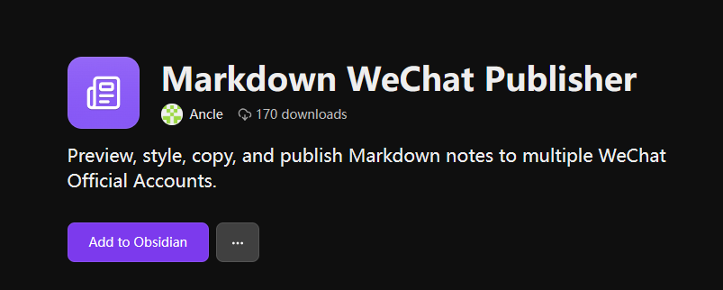
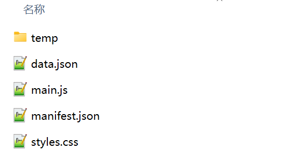
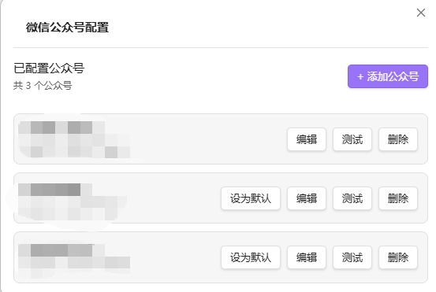
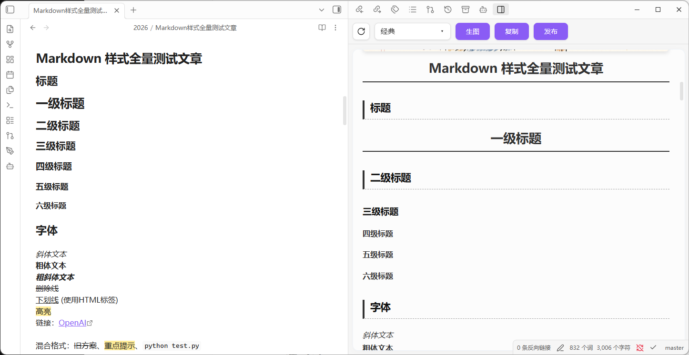

# Markdown WeChat Publisher

> Format, preview, and send drafts from Obsidian, keeping the focus on writing.

**Markdown WeChat Publisher** is an Obsidian plugin for previewing, styling, copying, and sending Markdown to WeChat Official Accounts. Adjust themes, generate illustrations, and crop covers in your note-taking environment, then copy the article to the WeChat editor or send it to the draft box.

[中文文档](README.md)

[](https://community.obsidian.md/plugins/markdown-wechat-publisher)
[](LICENSE)
[](https://github.com/zhangloveyan/obsidian-to-wechat/releases/latest)

## Core features

| Feature | Description |
| --- | --- |
| **Publish local Obsidian notes** | Preview Markdown formatting, copy it to the WeChat editor, or send it with local and remote images to the draft box |
| **Visual style editor** | Use built-in themes or create custom ones, with live adjustments for headings, paragraphs, quotes, code blocks, images, and tables |
| **Multiple accounts** | Manage accounts together, test connections, set a default, and select the target before publishing |
| **APIMart image generation** | Generate illustrations from `image-prompt` comments, edit prompts, track progress, and regenerate results; images are saved locally and prompts are retained |
| **WeChat cover cropping** | Drag and zoom within a fixed 2.35:1 frame; upload the crop as a separate PNG without changing the original image or note |

Code blocks include GitHub-style syntax highlighting, Mac-style headers, and line numbers.

## Getting started

### Install from the community plugin marketplace (recommended)

1. Open `Settings > Community plugins` in Obsidian and follow the prompt to enable community plugins.
2. Click `Browse` and search for `Markdown WeChat Publisher`.
3. Install and enable the plugin.

Plugin marketplace page:
[Markdown WeChat Publisher](https://community.obsidian.md/plugins/markdown-wechat-publisher)



### Manual installation

1. Download `main.js`, `manifest.json`, and `styles.css` from the [latest release](https://github.com/zhangloveyan/obsidian-to-wechat/releases/latest).
2. Create this folder inside your Obsidian vault and place the three files in it:

   ```text
   .obsidian/plugins/markdown-wechat-publisher/
   ```

3. Reload Obsidian and enable the plugin in `Settings > Community plugins`.

Use your custom configuration directory instead of `.obsidian` if you have changed it.



## Setup

Open `Settings > Markdown WeChat Publisher` and add an account in the account configuration dialog.

| Field | Description |
| --- | --- |
| **Account name** | A custom label to distinguish your accounts |
| **App ID** | The developer ID (AppID) for this WeChat Official Account |
| **App secret** | The developer secret (AppSecret) for this account |

Test the connection and choose a default account after entering the credentials. Sending drafts requires the corresponding WeChat API permissions; copying formatted content does not require account setup.



### Image generation settings (optional)

Enter the APIMart parameters in the image generation settings dialog:

- API URL, API key, and model.
- Aspect ratio and resolution.
- Timeout and polling interval.

Skip this setup if you do not use image generation. Testing the API generates a real image and saves it under `temp/` in the plugin directory for inspection.

## Usage guide

### Basic workflow

```text
Open a Markdown note -> Open preview -> Choose a theme and adjust styles
-> Generate images if needed -> Copy content or choose a cover and send a draft
```

1. Open a Markdown note.
2. Open the preview from the ribbon icon, or press `Ctrl+P` and search for `Markdown WeChat Publisher` in the command palette.
3. Choose a theme and adjust its styles in the theme editor as needed.
4. To add images, insert prompt comments and click the image generation button (`生图`).
5. Click Copy (`复制`) and paste into the WeChat editor, or click Publish (`发布`), choose the account, confirm the title and cover, and send the article to the draft box.

The plugin creates WeChat drafts. It does not broadcast articles to subscribers.

### Cover cropping

When publishing, choose an article image or a local file as the cover, then confirm to open the crop dialog:

- Drag and zoom within a fixed **2.35:1** frame.
- Click Apply to upload a separate PNG, up to 2350 x 1000 pixels without upscaling.
- **The original image and note remain unchanged.** Going back or cancelling preserves the previous cover; failed uploads can be retried.
- Cropping runs locally without a CDN and keeps the existing 10MB image limit.

### Article images

Put each prompt comment on its own line, keeping the entire comment on a single line:

```markdown
<!-- image-prompt: A clean blue technology cover image for a WeChat article -->
```

In the image generation dialog, edit prompts, generate one image or start all tasks, and check each image's status. Edited prompts are written back to the note when generation starts.

Images are saved under `pic/<note name>/` beside the note, and the image link is inserted or updated on the line immediately after its prompt. The prompt comment stays in the note but is hidden in the article preview, so you can reopen the dialog and regenerate the image later.

## Screenshots



## Technology

- TypeScript and the Obsidian API: plugin features and interface.
- esbuild: JavaScript and stylesheet bundling.
- highlight.js and juice: syntax highlighting and inline styles for WeChat HTML.
- Cropper.js 1.6.2: local cover cropping.

The minimum Obsidian version is 1.11.7; see [manifest.json](manifest.json) for the declared requirements.

### Project structure

```text
obsidian-to-wechat/
|-- src/
|   |-- core/              # Rendering, themes, transforms, and copying
|   |-- features/          # Preview, theme editor, settings, images, and publishing
|   |-- integrations/      # WeChat APIs and image handling
|   |-- shared/            # Shared utilities
|   |-- styles/            # Interface styles
|   `-- types/             # Data types
|-- scripts/              # Crop tests and local image API mock
|-- docs/                 # Plans, release notes, and release checklist
|-- pic/README/           # Documentation screenshots
|-- .github/workflows/    # Release automation
|-- manifest.json         # Plugin metadata
|-- package.json          # Dependencies and commands
`-- esbuild.config.mjs    # Build configuration
```

## Development

### Local build

Node.js and npm are required. The current release workflow uses Node.js 20.

```bash
# Install the locked dependency versions
npm ci

# Development mode (watch for changes)
npm run dev

# Production build
npm run build
```

Use the generated `main.js`, `manifest.json`, and `styles.css` in a test vault, following the manual installation steps.

### Tests

```bash
npm run test:cover
```

Cover crop tests use a locally installed Chrome by default. Set `PLAYWRIGHT_CHANNEL` to select another installed browser channel. WeChat uploads are mocked in these tests; no article is actually published.

## Privacy

- Account credentials, settings, and uploaded-image cache are stored in the current Obsidian vault. Do not publish configuration files containing secrets.
- Publishing sends articles and images to WeChat. Image generation sends prompts to the configured image generation service.
- Remote images are loaded from their source URLs. Exporting mathematical formulas as images sends their content to the CodeCogs rendering service.
- Cover cropping runs locally without a CDN. A cropped cover is uploaded to WeChat only when you apply it.

## FAQ

**Where can I get my App ID and App secret?**

Sign in to the [WeChat Official Account dashboard](https://mp.weixin.qq.com/). Find the account's AppID and manage its AppSecret in the developer configuration, then enter them in the plugin's account settings.

**What should I do if my IP is not on the allowlist?**

Add the public IP shown in the WeChat error message to the account's IP allowlist, then test the connection again. Changing networks or proxies can change your outbound IP.

**Does cropping change the original image?**

No. The crop is uploaded as a separate PNG; the original image and note are unchanged.

**Can I edit prompts and regenerate images later?**

Yes. Prompt comments stay in the note. Reopen the image generation dialog to edit and regenerate; a successful result updates the corresponding image link.

**Can I publish to multiple accounts at once?**

You can manage multiple accounts, but each publishing operation targets one selected account. The plugin does not broadcast to multiple accounts simultaneously.

## Contributing

Report bugs or suggest improvements through [Issues](https://github.com/zhangloveyan/obsidian-to-wechat/issues). Include reproduction steps and your Obsidian and plugin versions, and remove secrets from screenshots and logs.

For code contributions, fork the repository, create a branch, and open a pull request describing the change after running the relevant build and tests.

## License

This project is licensed under [AGPL-3.0](LICENSE).

## Related links

- [Obsidian community plugin page](https://community.obsidian.md/plugins/markdown-wechat-publisher)
- [Latest release](https://github.com/zhangloveyan/obsidian-to-wechat/releases/latest)
- [Release notes](docs/release-notes.md)
- [Issue tracker](https://github.com/zhangloveyan/obsidian-to-wechat/issues)
